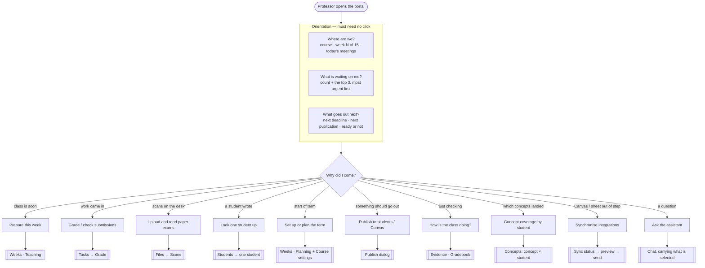
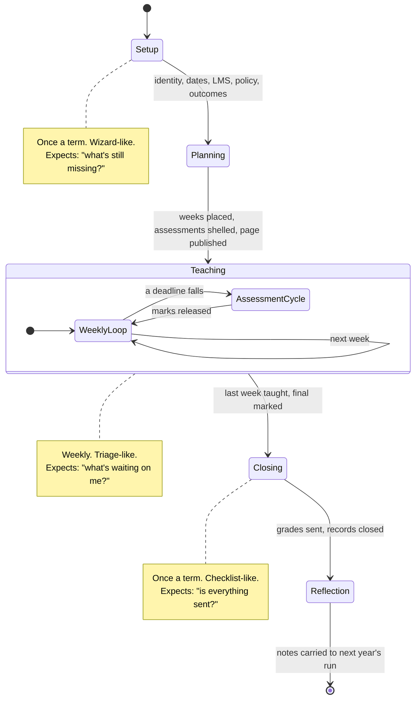
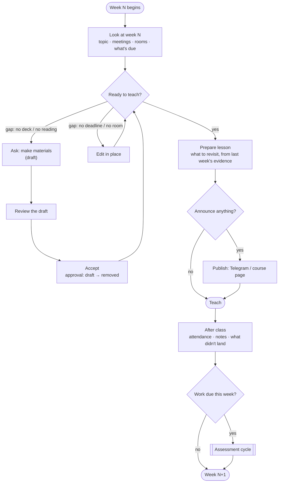
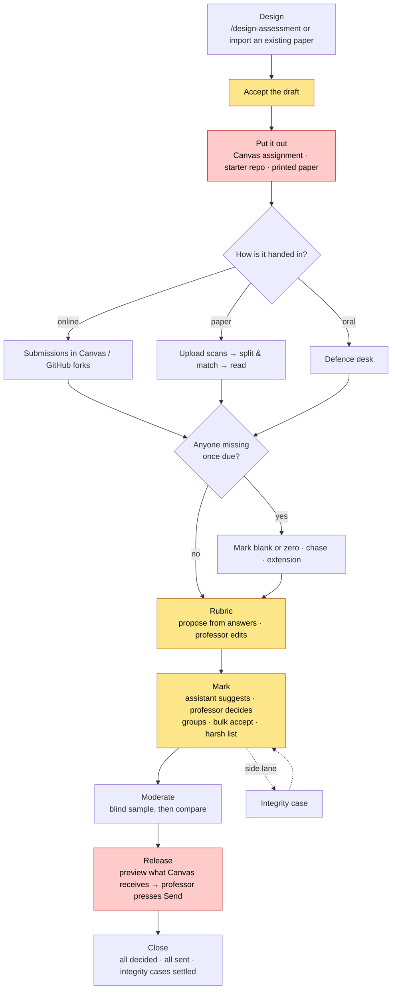
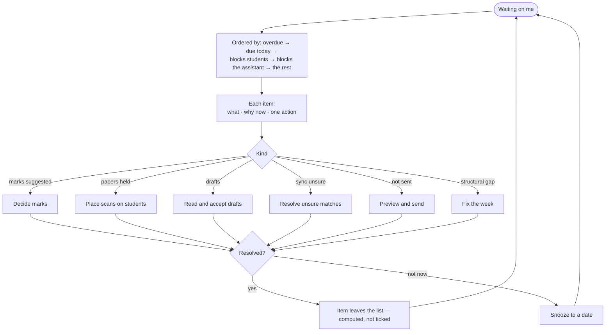
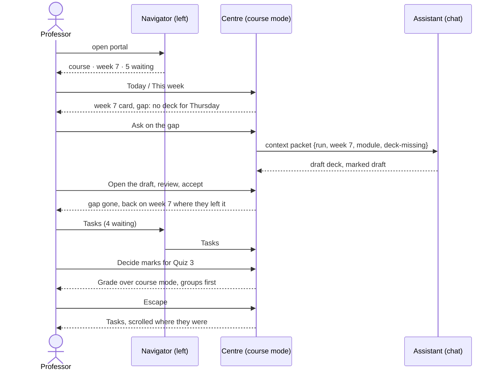
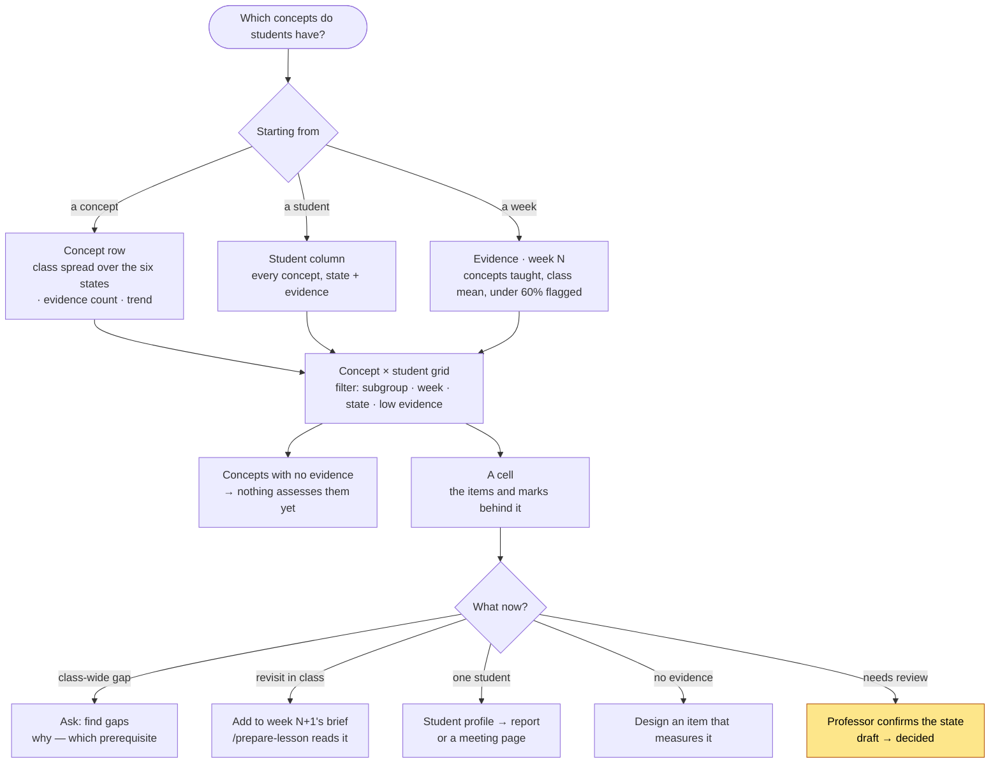
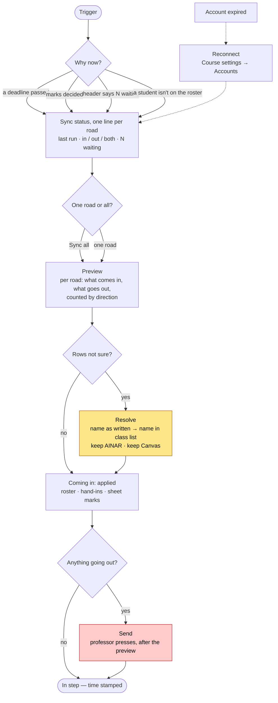
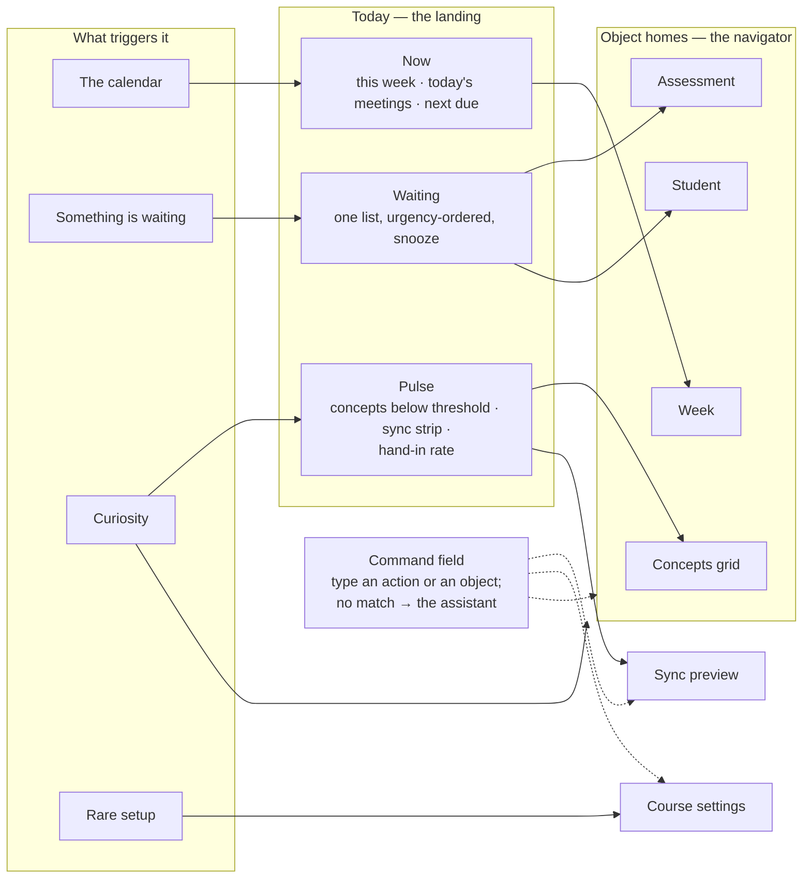

# What the professor expects when they open the portal

A UX note, written 2026-10-23. It describes the professor's work as they
experience it — by the calendar, by the week, by the deadline — and puts the
pane's places against it, to find where the portal answers a question the
professor is not asking yet, and where it makes them assemble an answer by
hand. The diagrams are Mermaid; GitHub and VS Code draw them.

Companions: [`WORKFLOWS.md`](WORKFLOWS.md) (how a process is modelled — a
case, not a flowchart) and [`EXAM-GRADING.md`](EXAM-GRADING.md) (one process
end to end). [`COURSE-MODE.md`](../plugins/dsh-professor-pane/COURSE-MODE.md)
is the layout this note assumes.

---

## 1 · The first five seconds

A professor does not open the portal to browse. They open it because
something on the calendar moved: a class tomorrow, a deadline last night, a
stack of scans on the desk, an email from a student. Before they press
anything they want three answers, in this order:

1. **Where are we?** Which course, which week, what happens today.
2. **What is waiting on me?** Not everything open — the things only I can do,
   most urgent first, with a count.
3. **What goes out next?** What students will see or receive soon, and
   whether it is ready.

Everything else — the gradebook, concepts, settings — is a place they go
*because* one of those three answers sent them there.

**What this asks of the landing.** Today the centre opens on a chat's empty
page, and the three answers are spread between the navigator (course, this
week, two counts) and places the professor has to open. The landing they
expect is a **Today** card in the centre: this week's meetings, the waiting
count with its top items as buttons, and the next thing due or going out —
each item one press from the place that resolves it. The chat's text field
sits at its foot, as it already does on an open place.

---

## 2 · The term, as the professor lives it

The professor's year has a shape, and what they expect from the same portal
changes with it. In week 0 they want structure; in week 6 they want a
to-do list; in week 15 they want a summary.

| Phase | The professor's question | Where the portal should put them | Today |
| --- | --- | --- | --- |
| Setup | What is still missing before I can plan? | a readiness checklist, one item at a time | `/onboard-course` in chat; Course settings |
| Planning | Is every week ready to teach? | Weeks · Planning with the Gaps tally | built |
| Teaching | What do I do this week? | Today → Weeks · Teaching | navigator's *This week*; no Today |
| Assessment | Where is each piece of work? | the assessment's own strip | chips on the week; Scans has a strip, others don't |
| Closing | Has everything gone out, is anything unmarked? | a close checklist | nowhere (EXAM-GRADING *Close — gap*) |
| Reflection | What should change next year? | `/course-reflection`, seeded with Evidence | chat only |

The landing should know the phase. Before term starts, *Today* is a
readiness list; during term it is the week; after the final it is the close
checklist. The phase is computed from the run's dates and records, never
stored — the rule [`WORKFLOWS.md` §2](WORKFLOWS.md#2--where-the-state-lives)
already set.

---

## 3 · The weekly loop

Most visits happen here. The unit is the week, and the loop runs roughly
from the weekend before a class to the day after it.

**Expectations this loop sets.**

- *Week N* is the object. Every gap, draft and deadline the loop touches is
  on the week card — COURSE-MODE built this, and it is the portal's
  strongest part.
- *Prepare lesson* reads last week's evidence. The professor expects the
  brief to know that week N−1's quiz went badly on a concept, without being
  told. Evidence is keyed by week now, so the link is one press away; the
  expectation is that it is zero.
- *After class* has no place. A professor who wants to note "concept X did
  not land, revisit Thursday" has only the chat. A short note on the week
  card, read by `/prepare-lesson` next time, closes the loop.

---

## 4 · The assessment cycle

The cycle the professor feels most, and the one most scattered across the
portal. One assessment is one case; the professor expects to open it once
and see where it stands.

Yellow is a **gate** — only the professor's decision moves it. Red is
**outward** — a student or Canvas sees the result; it wants a preview of
exactly what will be sent and one press.

**What the professor expects, and where the portal stands.**

- **One home per assessment.** Today the week chip shows the step and opens
  Grade, Scans, the defence desk or Publish over course mode — four windows
  for one case. The expectation is the strip Scans already has, for every
  assessment: the stages as dots, the current one as the press, side lanes
  beside. This is E36 drawn as a screen.
- **Counts, not lists, until asked.** "42 of 60 marked, 6 need you" before
  any table.
- **Nothing outward without a diff.** Release already previews; publishing an
  assessment's definition to Canvas should read the same way.

---

## 5 · Daily triage — the "what's waiting on me" list

When the professor's intent is "just clear what's waiting", the portal is
an inbox. What they expect from an inbox is familiar from mail: ordered by
urgency, each item says what it is, why now, and what one press does.

Two expectations the Tasks place does not meet yet: a single **urgency
order** across kinds (Tasks groups by Pending · Ready · Checklist, so the
professor does the merge), and **snooze** — "not this week" is a real
answer a professor gives, and an item they cannot dismiss turns the count
into noise.

---

## 6 · How a professor moves around

The pattern under all of the above: **orient → drill down → act → come back
to where they were**. Losing the place on return is the most common
frustration with tools like this.

The rules this implies, most already held:

- **Escape returns, never resets.** Course mode keeps the weeks mounted
  beneath a view for this reason.
- **Ask carries context.** The professor never types a week number or an id
  (UI-1…3).
- **The assistant's output lands as a draft on the object it was asked
  about**, not only as a chat message.
- **The UI says "the assistant"**, never a model name.

---

## 7 · Which concepts the students have

A professor asks this in three shapes, and each starts from a different
object:

- **By concept** — "is *gradient descent* landing?" → one concept, the class
  spread across its states.
- **By student** — "where is Aigerim stuck?" → one student, every concept.
- **By week** — "did last week's topic land?" → the concepts that week taught.

The states are the model's own (`concept_state`): *not observed ·
introduced · developing · demonstrated · consistently demonstrated · needs
review*. The professor expects to see them as one grid — concepts down,
students across, a colour per state — with three things the grid alone does
not say: which concepts have **no evidence yet** (nothing assessed them —
`concepts_with_no_evidence`), **how much evidence** a cell rests on (one quiz
item is not a verdict), and **why** a cell is red.

**Today.** *Concepts* in the navigator draws `class_progress` — the class by
concept. Evidence keys concepts by week. One student's concepts are a chat
request (`/student-dashboard`), not a place. **Expected:** the grid as the
Concepts place, with the student column one press from Students and the
concept row one press from a week's concept chip — the same document, entered
from three sides. It is private, names follow the Names / Pseudonyms switch,
and it never appears on anything a student sees.

---

## 8 · Synchronising the integrations

The run talks to four services: **Canvas** (class list, hand-ins, grades,
assignments), **Google Sheets** (the grade sheet the professor keeps, a
gradebook copy), **GitHub** (homework forks) and **Telegram** (the channel).
Each road has a direction — coming in, going out, or both.

What the professor wants from sync is the opposite of what they want from
setup. *Connecting* Canvas happens twice a term; *checking it is in step*
happens every week, usually after a deadline or before releasing marks. The
two are one place today (Course settings → Integrations), so the weekly
action lives behind the twice-a-term door.

**Today.** Each service's card in Integrations has its syncs with Preview /
Run, the waiting rows beside them, and *Sync all* for Canvas differences;
course mode's header carries *Canvas: connected · 5 waiting* and opens it.
The rules — what may be sent, what is held, what needs `--confirm` — live in
`ainar sync`, and stay there. **Expected:**

- **Sync is an operation, not a setting.** A sync strip — one chip per
  service, last run, waiting count — on the landing, with *Sync all* beside
  it. Settings keeps *connect*, *reconnect* and the choice of roads.
- **One preview for all roads**, grouped by service and direction, then one
  Send for everything outward — never a send per road.
- **Waiting rows join the triage list** (§5) as one item per service, not a
  separate queue.

---

## 9 · Every action, and where it starts

The portal does about fifty things. The table lists them by the object they
act on, with how often a professor does each, who does the work, whether it
is outward, where it starts today, and where it should start.

**Who:** P — the professor decides or presses; A — the assistant drafts
(a `/skill` in the session); S — the pane or CLI does it deterministically.
**Out:** ● — students or a service see the result.

### Course and term

| # | Action | How often | Who | Out | Today | Should start from |
| --- | --- | --- | --- | --- | --- | --- |
| T1 | Set up a course | once | A+P | | chat `/onboard-course` | Today, pre-term readiness |
| T2 | Connect Canvas, Google, GitHub, Telegram | once | P | | Course settings | Course settings |
| T3 | Import the class list (first time) | once | S | | CLI `ainar roster import` | Students, empty state |
| T4 | Build the concept map | once | A+P | | chat `/propose-concepts` | Concepts, empty state |
| T5 | Plan the term — weeks, meetings, exam shells | once | A+P | | `/plan-term`, Weeks · Planning | Weeks · Planning |
| T6 | Set or change the grading policy | rare | A+P | | Gradebook policy editor, `/grading-proposal` | Gradebook |
| T7 | Check outcomes against assessments | once | A | | chat `/syllabus-review`; no view | Today, pre-term readiness |
| T8 | Publish the course page | term + updates | S+P | ● | Publish | header Publish |
| T9 | Close the term | once | P | ● | nowhere | Today, after the final |
| T10 | Reflect on the term | once | A+P | | chat `/course-reflection` | Today, after close |

### Week

| # | Action | How often | Who | Out | Today | Should start from |
| --- | --- | --- | --- | --- | --- | --- |
| W1 | See this week | weekly | S | | navigator *This week* → Teaching | **Today** |
| W2 | Fix a week's gaps (deck, deadline, room) | weekly | P | | Planning chips | Week card |
| W3 | Draft materials | weekly | A | | Ask on a gap, `/make-materials` | Week card gap |
| W4 | Read and accept drafts | weekly | P | | open the record, Tasks | Waiting list |
| W5 | Edit a title, room or deadline | ad hoc | P | | pencil on the item | Week card |
| W6 | Move a topic to another week | rare | P | | Planning drag | Weeks · Planning |
| W7 | Prepare the lesson | weekly | A | | chat `/prepare-lesson` | Today → this week |
| W8 | Announce to students | weekly | A+P | ● | `/publish-telegram`, Publish | Week card, Publish |
| W9 | Note what did not land | weekly | P | | chat only | Week card, after class |

### Assessment

| # | Action | How often | Who | Out | Today | Should start from |
| --- | --- | --- | --- | --- | --- | --- |
| E1 | Design an assessment | per item | A+P | | `/design-assessment` | Week card, assessment slot |
| E2 | Import an exam already given | per item | A+P | | `/import-assessment` | Upload |
| E3 | Put it out (Canvas, starter repo, paper) | per item | S+P | ● | Publish, Integrations | Assessment home |
| E4 | Upload scans | per paper exam | S | | Files → Scans, week chip | Assessment home, Upload |
| E5 | Place held papers on students | per paper exam | P | | Scans | Waiting list |
| E6 | Run an oral defence | per defence | P | | defence desk | Assessment home |
| E7 | Set missing work to blank or zero | per item | P | | run or assessment setting | Assessment home |
| E8 | Propose and settle the rubric | per item | A+P | | Grade | Assessment home |
| E9 | Decide marks | per item | P | | Grade | Waiting list → assessment |
| E10 | Moderate — a blind sample | per item | P | | nowhere | Assessment home |
| E11 | Release marks to Canvas | per item | P | ● | Grade, Publish | Assessment home |
| E12 | Open an integrity case | rare | P | | nowhere | Assessment home, side lane |

### Student

| # | Action | How often | Who | Out | Today | Should start from |
| --- | --- | --- | --- | --- | --- | --- |
| P1 | Look a student up | ad hoc | S | | Students | Students, or search |
| P2 | See their concepts | ad hoc | S | | chat `/student-dashboard` | Student → concepts column |
| P3 | Write a report on them | ad hoc | A | | chat `/student-report` | Student |
| P4 | Grant an extension or exception | ad hoc | P | | nowhere | Student, or assessment row |

### Concept

| # | Action | How often | Who | Out | Today | Should start from |
| --- | --- | --- | --- | --- | --- | --- |
| C1 | See the class by concept | weekly | S | | Concepts (`class_progress`) | Concepts |
| C2 | See concept × student coverage | ad hoc | S | | partly, in Concepts | Concepts grid |
| C3 | Find concepts nothing has assessed | per term | S | | count only | Concepts, Today readiness |
| C4 | Ask why a concept is not landing | weekly | A | | chat `/find-gaps` | Concept row |
| C5 | Confirm a state marked *needs review* | ad hoc | P | | record | Waiting list |

### Integrations

| # | Action | How often | Who | Out | Today | Should start from |
| --- | --- | --- | --- | --- | --- | --- |
| I1 | See whether everything is in step | weekly | S | | course mode header line | **Today, sync strip** |
| I2 | Preview a sync | weekly | S | | service card | sync strip |
| I3 | Sync all roads | weekly | S+P | ● | Canvas card *Sync all* | **Today, sync strip** |
| I4 | Resolve unsure matches | weekly | P | | service card | Waiting list |
| I5 | Re-import students from Canvas | ad hoc | S+A | | `/sync-roster` | Students, sync strip |
| I6 | Reconnect an expired account | rare | P | | Accounts | sync strip warning → Accounts |

### Overview and the room

| # | Action | How often | Who | Out | Today | Should start from |
| --- | --- | --- | --- | --- | --- | --- |
| O1 | What is waiting on me | daily | S | | Tasks, `/action-inbox` | **Today, waiting list** |
| O2 | How the class is doing | weekly | S | | Evidence, Gradebook, `/course-dashboard` | Today pulse → Evidence |
| O3 | Status across all courses | daily | A | | `/course-status` | course switcher |
| O4 | Switch course | ad hoc | S | | navigator | navigator |
| O5 | Preview as a student | ad hoc | S | | course mode | header |
| O6 | Names or pseudonyms (projector) | per class | S | | toggle | header |
| O7 | Ask anything | any | A | | chat | the field at the foot of every place |

---

## 10 · What the entry point should be

Fifty actions do not fit in a navigator, and most of them should never be
looked for: they should **arrive**. Sorting the table by what *triggers* each
action, not by what it acts on, gives four kinds:

| Trigger | Share | Examples | The professor's stance | Entry point |
| --- | --- | --- | --- | --- |
| **The calendar** | ~20% | W1, W7, W8, T9, the phase | *it's that time* | Today — **Now** |
| **Something is waiting** | ~30% | W4, E5, E9, C5, I4, a held sync | *I'm needed* | Today — **Waiting** |
| **Curiosity** | ~30% | P1, P2, C1, C2, O2, I1 | *let me look* | the object's place, Today's **Pulse** as a doorway |
| **Rare setup** | ~20% | T2, T6, I6 | *once a term* | Course settings |

**The recommendation.**

1. **Today is the entry point.** Three bands — *Now*, *Waiting*, *Pulse* —
   and nothing else. It replaces the empty chat page as the centre on
   opening, and its content changes with the phase (§2).
2. **Every action has exactly one home**, the object it acts on — week,
   assessment, student, concept — or Course settings. Today never hosts an
   action; it **surfaces** one, as a link into its home, when its trigger
   fires. This keeps the fifty actions from piling up on one screen.
3. **Waiting is one list across every kind** — marks, held papers, drafts,
   states to confirm, unsure sync rows — computed from the records, so an
   item leaves when it is done, not when it is ticked.
4. **Pulse carries the two the professor asked for:** concept status (how
   many below threshold, how many with no evidence) and the **sync strip**
   (one chip per service, *Sync all*). Both are counts that open a place.
5. **A command field** at the foot of every place — the chat's text field,
   which is already there — matches actions and objects first ("sync
   canvas", "week 7", "Aigerim", "release quiz 3"), and passes anything it
   does not match to the assistant with the current place as context. It is
   the entry point for the curious and the expert; Today is the entry point
   for everyone else.
6. **The navigator stays** as the list of homes: Weeks, Tasks becomes
   *Waiting*, Students, Gradebook, Concepts, Materials, Files — and Course
   settings at the foot.

---

## 11 · Gaps between expectation and portal, in priority order

| # | Expectation | Today | Smallest step |
| --- | --- | --- | --- |
| 1 | Landing answers *where / waiting / next* with no click | centre opens on an empty chat | **Today** with Now · Waiting · Pulse (§10) |
| 2 | One urgency order across waiting items, with snooze | Tasks grouped by kind | sort key on inbox items; snooze date on the item |
| 3 | Sync is a weekly operation, one press for all roads | per-service cards inside Course settings | sync strip on Today, one preview, one Send (§8) |
| 4 | Concept × student coverage, entered from concept, student or week | class by concept; one student in chat | the Concepts grid, with evidence counts and no-evidence row (§7) |
| 5 | One home per assessment, stages visible | four windows from a chip | the Scans strip generalised (E36 / WF-2) |
| 6 | Outward actions preview exactly what is sent | Release does; Canvas definition push less so | one preview component for every outward press |
| 7 | Find any action by typing | chat only | the foot field matches actions and objects first (§10) |
| 8 | After-class note feeds next week's brief | chat only | a note field on the week, read by `/prepare-lesson` |
| 9 | A close checklist at term end | nowhere | the Close stage of EXAM-GRADING, at run level |
| 10 | Phase-aware entry: readiness before term, summary after | same landing all year | phase computed from dates + records |

§10 and this table are carried as work items in
[`BACKLOG.md` E37](../BACKLOG.md#e37--today-the-landing-and-every-action-with-one-home--no-futuremd-section-yet)
(HOME-1…14).

None of these writes a mark or moves the line in
[`COURSE-MODE.md`](../plugins/dsh-professor-pane/COURSE-MODE.md#the-line-that-does-not-move):
the pane draws and routes, the professor decides, the assistant drafts.
